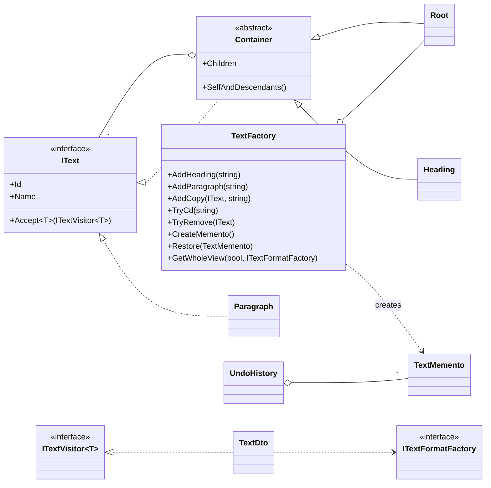
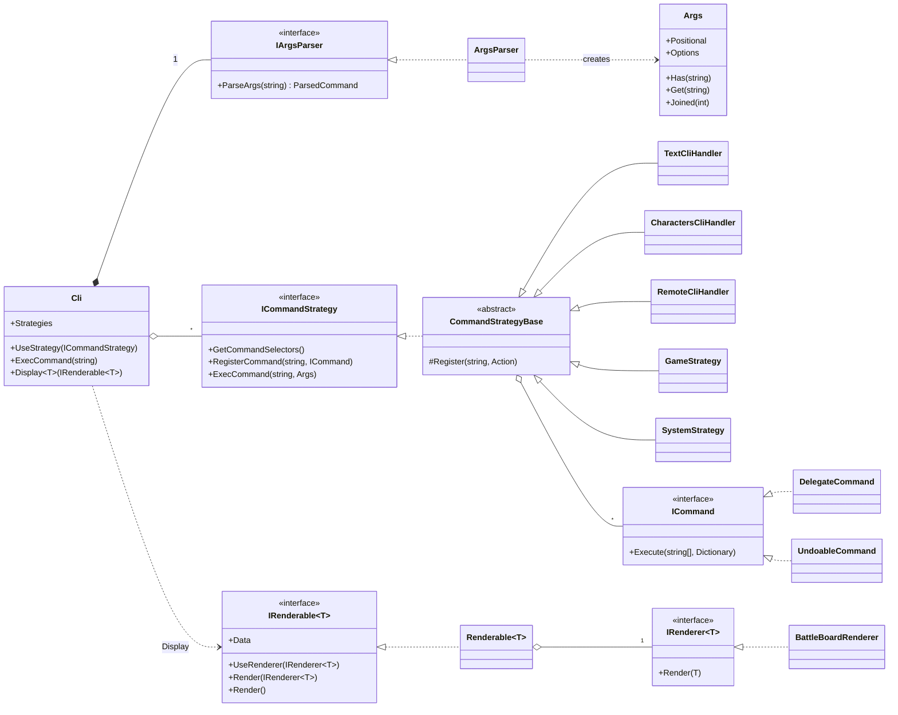
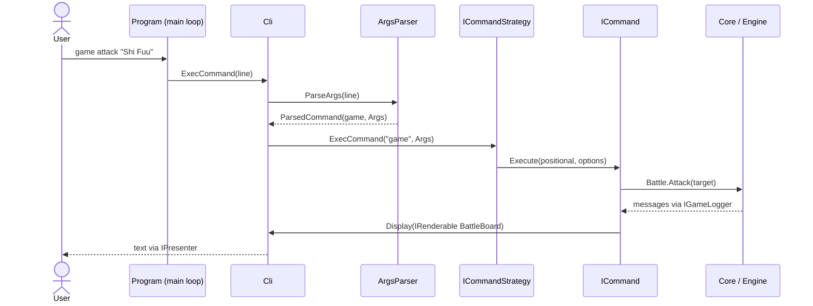
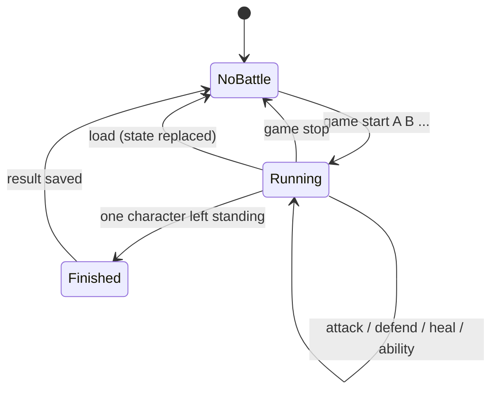

# Design Document: Character Battler

A console application in C# (.NET 8) that combines a structured text editor, a character catalog with a remote
database, and a turn-based text game. The document describes the structure of the application and, in detail,
the command line interface (CLI).

## Contents
1. Introduction
2. Requirements
3. Architecture
4. Domain model
5. Data design
6. Remote catalog
7. Command line interface (detailed)
8. Theme 2: text game
9. Theme 3: structured text editor
10. Testing
11. Limitations and future work
12. Build and run

## 1. Introduction

### 1.1 Purpose
The application lets a user work in a terminal with three subsystems that share one command line:
a catalog of characters (local and imported from a remote service), a turn-based text game, and an editor
of structured (hierarchical) text documents.

### 1.2 Themes of the project
| Theme | Name | Mode of the application |
|---|---|---|
| 1 | Character catalog | `--chars` (commands `create`, `add`, `ls`, `remote`, `sheet`, `save`, `load`) |
| 2 | Text game | `--chars` (commands `game ...`) |
| 3 | Own theme: structured text editor | `--text` (commands `add`, `rm`, `cp`, `cd`, `print`, `undo`, ...) |

### 1.3 Scope
In scope: the CLI and everything it needs from Core and Infra (some parts are simple but real implementations).
Out of scope for this version: a graphical interface, network play, saving of a battle in progress (see section 11).

### 1.4 Glossary
| Term | Meaning |
|---|---|
| Strategy (of the CLI) | A set of commands that belong together; plugged into the `Cli` |
| Selector | The name of a command (the first word of a typed line) |
| Renderable / renderer | An object that carries data / the object that turns that data into text |
| Memento | An opaque snapshot of the document used by `undo` |

## 2. Requirements

### 2.1 Functional requirements
**Theme 1: character catalog**
| Requirement | Implementation |
|---|---|
| Update and show the list of all available characters | `remote ls char` asks the service every time, so the list is always current; options `--find <text>`, `--limit <n>`; `ls char` lists the characters of the game |
| Show general information, including a link to the graphics | `remote show char <id>`: title, vision, weapon type, rarity, nation, affiliation, description, talents and the `Image` link |
| Create a new character through a dialog | `create char` (name, class, optional id), also `create item` and `create ability` |
| Save user data | `save <name>`, `load <name>`, `saves` (characters, items, abilities and their links) |
| Extra | `remote import char <id>` and `remote import weapon <id>` bring remote data into the game; `add item` equips; `sheet <character>` prints a character sheet |

**Theme 2: text game**
| Requirement | Implementation |
|---|---|
| Choice of characters | `game roster` lists the characters that can play (defeated ones are marked) |
| Start the game | `game start <A> <B> [...]` (two or more characters, by name or id) |
| Actions in the main loop | `game attack <target>`, `game defend`, `game heal [<target>] [--amount <hp>]`, `game ability <target> [--id <ability>]`, `game status`, `game stop` |
| Save state and results | State of the characters: `save` / `load`. Results of finished battles are saved automatically; `game results` shows them |

**Theme 3: structured text editor**
| Requirement | Implementation |
|---|---|
| Operations of the theme | `add` (heading or paragraph), `rm`, `cp` (copy a subtree), `cd`, `up`, `undo` |
| Output of the information the theme needs | `pwd` (path), `print` of the current element or the whole document, with ids (`--id`) and in a chosen format (`--format plain\|html\|markdown`) |
| Persistence | `save <name>`, `load <name>`, `saves` |

### 2.2 Non-functional requirements
* **Extensibility:** a new command, strategy, output format or renderer is added without changing existing code.
* **Testability:** no direct calls of `Console` outside the infrastructure layer; the console and the network are replaceable.
* **Robustness:** an error in a command is reported to the user and never ends the program.

## 3. Architecture

### 3.1 Layers

Dependencies point only downwards: Core knows nothing about the CLI, Infra knows nothing about Core or the CLI.

### 3.2 Projects
| Project | Responsibility |
|---|---|
| `SOLID` | CLI: `Cli`, command strategies, renderers, `Presenter`, entry point |
| `OOPTextProject` | Structured text system |
| `GameSystem.Core` | Characters, items, abilities, DTOs, import from the remote service |
| `GameSystem.Engine` | `Game` and the turn-based `Battle` |
| `Infra` | `Display` (output), `Data` (JSON persistence), `WebApi` (HTTP client) |
| `OOPProject.Tests` | Unit tests of all layers |

### 3.3 Design patterns in use
| Pattern | Where |
|---|---|
| Facade | `Cli` (CLI), `TextFactory` (text system), `ListEditor`-like facades hide subsystems behind few calls |
| Strategy | Command strategies of the CLI; abilities of characters (`IAbility`); `IRenderer<T>`; `IRepositoryStorage`; `IGameDataApi` |
| Command | `ICommand`, `DelegateCommand`, `UndoableCommand` |
| Composite | The document tree (`Root`, `Heading`, `Paragraph`) |
| Visitor | `TextDto` (formatting) and `TextMapper` (conversion to data) |
| Iterator | `Container.SelfAndDescendants()` |
| Memento | `TextMemento`, `UndoHistory`, `TextFactory.CreateMemento/Restore` |
| Abstract Factory | Output formats of documents (`ITextFormatFactory`: plain, HTML, Markdown) |
| Builder | `DocumentBuilder` (also used for character sheets) |
| Prototype | Copying subtrees (`cp`) |
| Template Method | `EntityDto` (short or detailed form of game DTOs) |

## 4. Domain model

### 4.1 Characters
`Character` has health, armor, attack power, an equipped `Item`, a unique ability and learned abilities.
Concrete classes: `HalfOrcBarbarian`, `Monk`, and `ApiCharacter` (created from the remote database).
Abilities implement `IAbility`: `RageAbility`, `FlurryOfBlowsAbility`, `CustomAbility`.
`GameState` holds three registries (characters, items, abilities) whose objects are addressed by id or by name.
`GameSession` holds the current `GameState`, so all strategies see the same state, also after `load`.

### 4.2 Structured text

Every element has a unique id (the root has id 0). `TextFactory` keeps the current position, so commands
such as `add` and `cd` work relative to it.

### 4.3 Battle
`Battle` keeps the order of turns, the round number, defense and the winner. Rule violations are reported with
`InvalidOperationException`; the turn is not spent. `Battle.CreateView()` returns the state as data
(`BattleBoard`), without any text.

## 5. Data design
All saved data live in one JSON file, `saves.json` (class `Repository`):

| Section | Content |
|---|---|
| `CharacterSaves` | Named saves: characters, items, abilities and the links between them |
| `TextSaves` | Named saves: the document as a tree of nodes |
| `BattleResults` | Winner, participants, rounds, actions and time of every finished battle |

The storage is replaceable (`IRepositoryStorage`); `SaveManager` offers named saves on top of it. An older file
without `BattleResults` still loads.

## 6. Remote catalog
`GenshinApiClient` is an HTTP client for the service at https://genshin.jmp.blue (project: genshindev/api).
It uses the endpoints `characters`, `characters/{id}`, `weapons` and `weapons/{id}` and converts the JSON to
`RemoteCharacter` and `RemoteWeapon`. The parser is tolerant: only the name is required.
The link to the graphics is the `image` field of the answer; when it is absent, the client builds it from the
endpoint `characters/{id}/card`.

`RemoteImporter` translates remote data to the game:

| Remote data | Game object |
|---|---|
| Character | `ApiCharacter` with a profile |
| Stats (the service has none) | Generated from a range that depends on the rarity of the character |
| Talents | Abilities (burst: 3 hits, skill: 2 hits, others: 1 hit); the burst is the unique ability |
| Weapon | `Item` (attack bonus is base attack / 5, health and armor bonus depend on rarity) |

If the service is unavailable, the application can run with `--offline` and uses built-in samples
(`OfflineGameDataApi`), parsed by the same parser.

## 7. Command line interface (detailed)

### 7.1 Purpose and principles
The CLI belongs to the presentation layer. It accepts a line typed by the user, finds the command, runs it
through the logic of Core and shows the result. It contains no game rules: the rules are in `Battle`,
`Character` and `TextFactory`. Commands of one subsystem are grouped into a **strategy**; the CLI is parametrized
with strategies, so a subsystem can be added or removed without touching the others.

### 7.2 Structure


### 7.3 Components
| Component | Responsibility |
|---|---|
| `Cli` | Facade with three operations: `UseStrategy`, `ExecCommand`, `Display<T>`. Owns the parser (composition) and the list of strategies (aggregation) |
| `IArgsParser` / `ArgsParser` | Turns a raw line into `ParsedCommand` (selector and `Args`) |
| `Args` | Object form of the arguments: positional words and options (case-insensitive names) |
| `ICommandStrategy` | A set of commands: `GetCommandSelectors`, `RegisterCommand`, `ExecCommand` |
| `CommandStrategyBase` | Table "selector to command"; concrete strategies register commands in their constructors |
| `ICommand` and its implementations | A command as an object; `DelegateCommand` wraps a method, `UndoableCommand` adds undo |
| `IRenderable<T>` / `IRenderer<T>` | Data that can be shown / the strategy that turns the data into text |
| `Presenter` (`IPresenter`) | The only way strategies read from and write to the user; works over `IDisplayer` and `IInputReader` |
| `SystemStrategy` | The command `commands`, which lists the selectors of every strategy |
| `CommandInterpreter` | A thin adapter of the old API on top of `Cli` (kept so existing code and tests keep working) |

Correspondence with the reference design: `useStrategy` is `Cli.UseStrategy`, `execCommand` is `Cli.ExecCommand`,
`display` is `Cli.Display<T>`, `ArgParser.parseArgs` is `IArgsParser.ParseArgs`. The second variant of the
rendering design is used: the renderable owns its renderer, and the CLI supplies the renderer. A deviation:
`RegisterCommand` takes an `ICommand` object (a method is wrapped in `DelegateCommand`) instead of a bare function.

### 7.4 Execution of a command


### 7.5 Modes and start-up
| Argument | Mode |
|---|---|
| `--text` | Structured text editor (strategy `TextCliHandler`) |
| `--chars` | Characters, remote catalog and game (strategies `CharactersCliHandler`, `RemoteCliHandler`, `GameStrategy`) |
| `--chars --offline` | The same, with built-in sample data instead of the remote service |
| none | A dialog asks which mode to start |

`SystemStrategy` is plugged in in both modes. The prompt is `>`; `exit` ends the program.

### 7.6 Parsing rules
The first word is the selector. The other words are positional arguments and options. `--name value` is an
option with a value, `--flag` is a flag (the value is empty). Text in quotes (`"..."`, `'...'`, `“...”`, `«...»`)
is one word. A quote opens a quoted text only at the beginning of a word, so an apostrophe inside a word
(`п'ять`, `don't`) stays an ordinary character. Names of options are case-insensitive.

### 7.7 Error handling
* An unknown command is reported (`Unknown command: ...`).
* An exception inside a command is caught by `Cli` and shown as `[Error executing command]: ...`; the program continues.
* Breaking a rule of the game is shown by `GameStrategy` as a plain message (it is not a failure of the program).
* Network errors and unexpected answers of the service are `RemoteApiException` with a readable message.
* Commands that change the document ask for confirmation where data can be lost (`rm`, `load`).

### 7.8 Output
Objects that present themselves (DTOs of the game, `TextDto`) implement `IDisplayable`. Data without its own
presentation (the battle board, the list of playable characters, the results) are passed as `Renderable<T>`:
the core provides the data and the CLI sets the renderer (`BattleBoardRenderer`, `RosterRenderer`,
`ResultsRenderer`). A GUI would provide its own renderers for the same data. All reading and writing goes through
`IPresenter`, which uses `IDisplayer` and `IInputReader`; the console is replaced by test doubles in tests.

### 7.9 Commands
| Strategy | Commands | Kind |
|---|---|---|
| `TextCliHandler` | `pwd`, `print`, `add`, `rm`, `up`, `cd`, `cp`, `undo`, `save`, `load`, `saves`, `help` | transform, output, persistence |
| `CharactersCliHandler` | `create`, `add`, `act`, `ls`, `save`, `load`, `saves`, `help` | transform, output, persistence |
| `RemoteCliHandler` | `remote ls\|show\|import`, `sheet` | infrastructure, output |
| `GameStrategy` | `game roster\|start\|status\|attack\|defend\|heal\|ability\|stop\|results` | transform, output |
| `SystemStrategy` | `commands` | output |

### 7.10 Extension points
* **A new command:** write a method in a strategy and add `Register("name", Method)`.
* **A new strategy:** derive from `CommandStrategyBase`, register commands in the constructor and plug it in with `cli.UseStrategy(...)` in `Program`.
* **A new way to show data:** implement `IRenderer<T>`; the core is not changed.
* **A new document format:** implement `ITextFormatFactory` and add it to `TextFormats`.
* **Undo for a command:** wrap it in `UndoableCommand`.
* **A graphical interface:** a new project in the presentation layer that reuses Core, Data and WebApi.

## 8. Theme 2: text game


**Rules.** A battle has two or more characters. They act in the given order, one action per turn. A round ends
when every living character has acted. Defense lasts until the next round. The winner is the last character
standing. After a `load` the battle is abandoned, because it belongs to the replaced state.

**Typical session**
```
> game roster
> game start Albedo Amber
> game attack Amber
> game defend
> game status
> game results
```
The result of a finished battle (winner, participants, rounds, actions, time) is appended to `saves.json`.

## 9. Theme 3: structured text editor

### 9.1 Description
A document is a tree: a root (the title), headings (containers) and paragraphs (leaves). The user moves
around the tree like in a file system and changes it with commands. The same text system builds the character
sheets of Theme 1 (`sheet <character> --format html`).

### 9.2 Commands
| Command | Meaning |
|---|---|
| `pwd` | Current path, for example `/Chapter 1` |
| `add <container\|leaf> <heading\|paragraph> ["text"]` | Add an element (a dialog asks for the text when it is missing); `add heading "x"` is a shortcut. A new heading becomes the current one |
| `cd <path>` / `cd --id <id>` | Go to a container by path (`/a/b`, `../x`) or by id |
| `up` | Go to the parent |
| `rm [<name>]` / `rm --id <id>` | Remove an element after confirmation; without a name the current element |
| `cp <name> [--as <new name>]` / `cp --id <id>` | Copy an element with all its content (new ids) |
| `print [--whole] [--id] [--format plain\|html\|markdown]` | Show the current element or the whole document, optionally with ids and in a format |
| `undo` | Undo the last change made by `add`, `rm`, `cp` or `load` |
| `save <name>`, `load <name>`, `saves` | Save, restore and list documents |

### 9.3 Example session
```
> add heading "Chapter 1"
Heading 'Chapter 1' added (id 1). Current path: /Chapter 1
> add paragraph "Hello"
Paragraph added (id 2).
> up
Moved up to parent element. Current path: /
> cp "Chapter 1" --as "Chapter 2"
Copied Heading 'Chapter 1' (id 1) as 'Chapter 2' (id 3, 2 element(s)).
> print --whole --id
[0] Title: Main Document
    [1] Chapter 1
        [2] Hello
    [3] Chapter 2
        [4] Hello
> print --whole --format markdown
# Main Document

## Chapter 1

Hello

## Chapter 2

Hello
> undo
Undone. Current path: / (2 more step(s) can be undone).
```

### 9.4 Design notes
* Output formats are an Abstract Factory (`ITextFormatFactory`); `TextDto` is a visitor that walks the tree.
* `DocumentBuilder` builds a document step by step and refuses an unfinished one.
* `undo` takes a snapshot (`TextMemento`) before every command that changes the document and stores it in `UndoHistory` only if the document really changed (`TextFactory.Revision`).
* Moving around the document (`cd`, `up`) and printing are not steps of the history.

## 10. Testing
Unit tests (xUnit with Moq) cover every layer: the text system, the characters, `Battle`, the CLI facade, the
parser, the strategies, the renderers, the game and text commands, the JSON storage and the WebApi client.
The console and the network are replaced by test doubles (`DisplayerMock`, `InputReaderStub`,
`StubHttpMessageHandler`, `FakeGameDataApi`, `InMemoryStorage`). Run them with `dotnet test`.

## 11. Limitations and future work
* A battle in progress is not saved: the state of the characters and the results are.
* There is no redo, and `undo` is available only in the text mode.
* `help` describes the commands of its own strategy; `commands` lists all of them.
* The remote service may be unavailable; `--offline` is the fallback.
* Planned: a graphical interface, saving of a battle in progress, `export` of a document to a file.

## 12. Build and run
Requirements: .NET 8 SDK.
```
dotnet build
dotnet test
dotnet run --project SOLID -- --text
dotnet run --project SOLID -- --chars
dotnet run --project SOLID -- --chars --offline
```