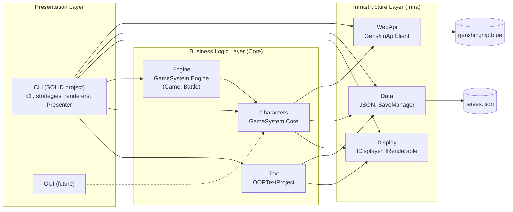
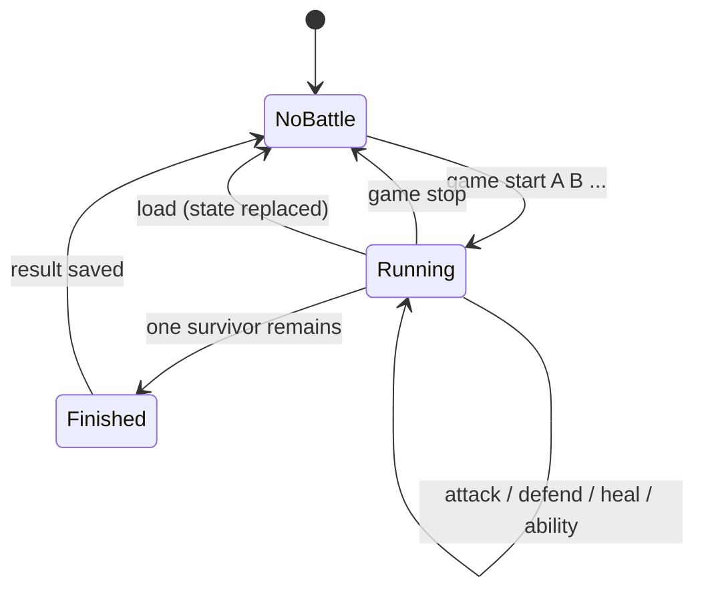

# Design Document: "Character Battler"

A C# (.NET 8) console application featuring text-based content, characters, a catalog of characters and weapons retrieved from a remote service, and a text-based battle game. This document outlines the application structure and details the Command Line Interface (CLI).

## 1. Scope and Objectives
* Provide a console-based interface for three subsystems: text editing, character/catalog management, and combat.
* The interface (CLI) is decoupled from the business logic (Core) and data layer (Infra), allowing for the future addition of a GUI without modifying the Core.
* Out of scope for this version: a graphical user interface (GUI), multiplayer/network play, and saving in-progress battles (see Section 10).

## 2. Requirements
| Topic | Requirement | CLI Implementation |
|---|---|---|
| Catalog | Update and display a list | `remote ls char\|weapon` (always queries the service) |
| Catalog | General information, image references | `remote show char <id>` (includes an `Image` field) |
| Catalog | Create a character via an interactive dialog | `create char`, `create item`, `create ability` |
| Catalog | Save user data | `save <name>`, `load <name>`, `saves` |
| Game | Select characters | `game roster`, `game start <A> <B> ...` |
| Game | Start the game and execute action loops | `game start`, `game attack/defend/heal/ability`, `game status` |
| Game | Save game state and results | `save`/`load` (character state), `game results` |

Non-functional requirements: extensibility (adding new commands, strategies, or output formats without modifying existing code), testability
(no direct calls to `Console` outside the Infra layer), and fault tolerance (a command error does not terminate the program).

## 3. Architecture

Dependencies flow only downwards: Core is unaware of CLI; Infra is unaware of both Core and CLI.

### Projects
| Project | Purpose |
|---|---|
| `SOLID` | CLI: `Cli`, command strategies, renderers, `Presenter`, entry point |
| `OOPTextProject` | Text System (Composite, Visitor, Prototype, Builder, Memento) |
| `GameSystem.Core` | Characters, items, abilities (Strategy), DTOs, import from a remote service |
| `GameSystem.Engine` | `Game` and turn-based `Battle` |
| `Infra` | `Display` (output), `Data` (JSON persistence), `WebApi` (HTTP client) |
| `OOPProject.Tests` | Unit tests for all layers |

## 4. Domain
* **Characters:** `Character` (HP, armor, attack, item, abilities), classes such as `HalfOrcBarbarian` and `Monk`,
plus `ApiCharacter` (from a remote catalog). Abilities implement `IAbility` (Strategy pattern).
* **Text:** A tree structure—`Root` → `Heading` → `Paragraph` (Composite pattern)—processed via visitor operations.
* **Battle:** The `Battle` class manages turn order, rounds, defense status, and the winner; it exposes data for display via a `BattleBoard` object.

## 5. Data and Persistence
A single `saves.json` file (`Repository`) stores `CharacterSaves`, `TextSaves`, and `BattleResults`. The storage implementation
is swappable (`IRepositoryStorage`). Character states are saved via a `save` command, while the results of completed battles
are recorded automatically.

## 6. Remote Catalog
`GenshinApiClient` (HTTP) retrieves data—`characters`, `characters/{id}`, `weapons`, `weapons/{id}`—and converts the JSON into
`RemoteCharacter` / `RemoteWeapon` objects. `RemoteImporter` maps them to internal classes: statistics are generated based on rarity, talents become abilities, and weapons become items. If the service is unavailable, the `--offline` mode is used.

## 7. Console Interface (In Detail)

### 7.1 Purpose and Principles
The CLI belongs to the presentation layer. It accepts a string from the user, identifies the command, executes it via the Core logic, and outputs the result. The CLI does not contain game rules; the rules reside within `Battle`, `Character`, and `TextFactory`.
Each subsystem contributes its own set of commands to the CLI; therefore, commands are grouped into **strategies**.

### 7.2 Class Structure
```mermaid
classDiagram
direction LR
class Cli {
+UseStrategy(ICommandStrategy)
+ExecCommand(string)
+Display~T~(IRenderable~T~)
+Strategies
}
class IArgsParser {
<<interface>>
+ParseArgs(string) ParsedCommand
}
class ArgsParser
class Args {
+Positional
+Options
+Has(string)
+Get(string)
+Joined(int)
}
class ICommandStrategy {
<<interface>>
+GetCommandSelectors()
+RegisterCommand
(string, ICommand)
+ExecCommand(string, Args)
}
class CommandStrategyBase {
<<abstract>>
#Register(string, Action)
}
class ICommand {
<<interface>>
+Execute(string[], Dictionary)
}
class DelegateCommand
class UndoableCommand
class IRenderable~T~ {
<<interface>>
+Data
+UseRenderer(IRenderer~T~)
+Render(IRenderer~T~)
+Render()
}
class IRenderer~T~ {
<<interface>>
+Render(T)
}
class Renderable~T~
class BattleBoardRenderer
class TextCliHandler
class CharactersCliHandler
class RemoteCliHandler
class GameStrategy
class SystemStrategy
Cli *-- IArgsParser : 1
IArgsParser <|.. ArgsParser
ArgsParser ..> Args : creates
Cli o-- "*" ICommandStrategy
ICommandStrategy <|.. CommandStrategyBase
CommandStrategyBase <|-- TextCliHandler
CommandStrategyBase <|-- CharactersCliHandler
CommandStrategyBase <|-- RemoteCliHandler
CommandStrategyBase <|-- GameStrategy
CommandStrategyBase <|-- SystemStrategy
CommandStrategyBase o-- "*" ICommand
ICommand <|.. DelegateCommand
ICommand <|.. UndoableCommand
IRenderable~T~ <|.. Renderable~T~
Renderable~T~ o-- "1" IRenderer~T~
IRenderer~T~ <|.. BattleBoardRenderer
Cli ..> IRenderable~T~ : Display
```

### 7.3 Correspondence to the Lecture Diagram
| Lecture | Code | Note |
|---|---|---|
| `CLI.useStrategy` | `Cli.UseStrategy` | Strategy selectors are registered in the `Cli` table; a later strategy overrides an earlier one |
| `CLI.execCommand` | `Cli.ExecCommand` | Parsing, strategy selection, error display |
| `CLI.display` | `Cli.Display<T>` | Alternative diagram variant: the renderer stores the object itself |
| `ArgParser.parseArgs` | `IArgsParser.ParseArgs` | `Cli` owns the parser (composition) |
| `Args` | `Args` | Positional arguments and options; case-insensitive |
| `ICommandStrategy` | `ICommandStrategy`, `CommandStrategyBase` | Base class with a command table added |
| `Command` | `ICommand`, `DelegateCommand`, `UndoableCommand` | Command as an object; methods can also be registered |
| `IRenderable<T>` / `IRenderer<T>` | `Infra.Display` | The core provides data; the CLI supplies the renderer |

Deviation: in the diagram, `registerCommand` accepts a function, whereas in the code, it uses `ICommand` (with a `DelegateCommand` adapter).
The `CommandInterpreter` class is retained as a thin adapter for the legacy API over `Cli`, avoiding the need to rewrite existing tests. ### 7.4 Command Execution


### 7.5 String Parsing
The first word is the selector. The remaining words are positional arguments and options. `--name value` specifies an option with a value,
while `--flag` (without a value) is a flag. Text enclosed in quotation marks (`"..."`, `'...'`, `“...”`, `«...»`) is treated as a single word; a quotation mark
only initiates a quoted segment at the beginning of a word, so an apostrophe within a word (e.g., `п'ять`) remains a standard character.
Option names are case-insensitive.

### 7.6 Error Handling
* Unknown command: displays the message `Unknown command`.
* Exceptions occurring within a command are caught by `Cli` and displayed as `[Error executing command]: ...`; the program continues to run.
* Violations of game rules (`InvalidOperationException` / `ArgumentException` originating from `Battle`) are displayed by `GameStrategy`
as a simple message without any prefix. * Network errors and invalid service responses are represented as `RemoteApiException` with a descriptive message.

### 7.7 Output
Objects capable of displaying themselves (character DTOs, `TextDto`) implement `IDisplayable`. Data lacking its own
presentation logic (the battle board, the character list, results) is handled via `Renderable<T>`: the Core provides the data,
while the CLI supplies the renderer (`BattleBoardRenderer`, `RosterRenderer`, `ResultsRenderer`). The GUI will provide
its own renderers for the same data. All input/output operations pass through an `IPresenter`, which in turn interacts
with an `IDisplayer` / `IInputReader` (the console can be swapped out during testing).

### 7.8 Strategies and Commands
| Strategy | Commands | Category |
|---|---|---|
| `TextCliHandler` (`--text`) | `pwd`, `print`, `add`, `rm`, `up`, `cd`, `cp`, `undo`, `save`, `load`, `saves`, `help` | transformation, output, persistence |
| `CharactersCliHandler` | `create`, `add`, `act`, `ls`, `save`, `load`, `saves`, `help` | transformation, output, persistence |
| `RemoteCliHandler` | `remote ls\|show\|import`, `sheet` | infrastructure actions, output |
| `GameStrategy` | `game roster\|start\|status\|attack\|defend\|heal\|ability\|stop\|results` | game logic
creation, output |
| `SystemStrategy` | `commands` | output |

### 7.9 How to Extend
* **New command:** a method within a strategy, plus `Register("name", Method)`.
* **New strategy:** a subclass of `CommandStrategyBase`, with `Register(...)` in the constructor, and `cli.UseStrategy(...)` in `Program`.
* **New data view:** an `IRenderer<T>` class; the core remains unchanged.
* **Undo functionality:** wrap the command in an `UndoableCommand` (text mode).
* **GUI:** a new project in the presentation layer that utilizes the existing Core, Data, and WebApi components.

## 8. Text-based Game

Rules: requires at least two participants; turns proceed in a cycle, with one action per turn; a round concludes once all surviving participants have taken an action;
defense lasts until the next round; the winner is the last survivor. The result of a completed battle (winner,
participants, rounds, actions, duration) is saved to `saves.json`.

## 9. Testing
xUnit unit tests (using Moq) for every layer, including `Cli`, `ArgsParser`, strategies, `GameStrategy`,
`Battle`, renderers, the WebApi client, and the storage repository. The console and network are replaced by test doubles
(`DisplayerMock`, `InputReaderStub`, `StubHttpMessageHandler`, `FakeGameDataApi`, `InMemoryStorage`).

## 10. Limitations and Plans
* An ongoing battle is not saved (only character states and results are saved); it is not possible to resume a battle after a `load` operation.
* There is no undo/redo functionality in character mode.
* The `help` command describes commands specific to the current strategy; the `commands` command provides a complete list.
* Future work: GUI, saving battles, and network-based battles.

## 11. Execution
```
dotnet run --project SOLID -- --text
dotnet run --project SOLID -- --chars            # with a remote catalog
dotnet run --project SOLID -- --chars --offline  # using built-in samples
```